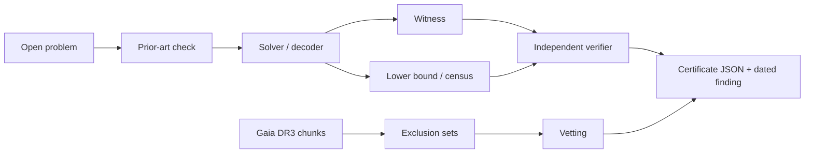

<div align="center">

# Open Research Lab

**Work you can re-check.**

[Website](https://adineo-cmd.github.io/open-research-lab/) · [Findings](open-discovery-lab/FINDINGS.md) · [How it works](#how-it-works)

 

[](https://github.com/adineo-cmd/open-research-lab/stargazers) [](https://github.com/adineo-cmd/open-research-lab/commits)

</div>

---

This is the single consolidated record of the lab's work. The former
**Open Discovery Lab** has been merged into `open-discovery-lab/` here and its
separate repository retired. The showcase website in [`docs/`](docs/) renders
this repository's own data — it is regenerated from the findings ledger and
the certificate tree, not maintained by hand.

It currently carries **190 machine-checkable certificates**, **77 dated
findings** spanning firmware, file formats, sky objects and integer sequences,
a full-sky Gaia DR3 harvest of **130,318 sources**, a discovery registry of
**8,000 sources** across 21 categories, and the record of **ten reasoning
instruments** built elsewhere.

## What the website shows

A seven-page, mobile-first site, not a single demo page:

| Page | Contents |
| --- | --- |
| `index.html` | Home: register, in-progress cells, latest findings, recent repositories and commits. |
| `findings.html` | Searchable, filterable 77-entry findings ledger with expandable detail. |
| `research.html` | Research tracks, selected proved results and certificate counts. |
| `librephone.html` | LibrePhone contributions, firmware areas and the boundary rules. |
| `projects.html` | All 29 public adineo-cmd repositories, searchable and filterable by language. |
| `apps.html` | The ten reasoning instruments, Atrium and the data-boundary rules. |
| `method.html` | The five steps, what is not claimed, and how the site is generated. |

## Features

| | Feature | What it does |
| --- | --- | --- |
| 📡 | **Firmware & format findings** | 77 dated entries, many of them first public decoders or specs, with reproducible scripts. |
| 🔢 | **Grid Ramsey values** | Four new exact OEIS values on row 9 of A399621, plus the first bounds for the open a(9). |
| 🎯 | **Property-B covering** | A385403 extended with a(11)=9, a(12)=9 and a(13)=9 exact (a(13) via a counting proof). |
| 🧭 | **Directed Ramsey** | Erdős #112: verified circulant witnesses improve the k(4,4) lower bound from 34 to 40. |
| 🌌 | **High-proper-motion harvest** | Full-sky Gaia DR3 scan in 4,096 indexed chunks, then multi-epoch vetting. |
| 🗂️ | **Discovery registry** | 8,000 sources scored and categorised, with attribution kept per entry. |
| 🧾 | **LibrePhone record** | Clean-room ISA and format analysis; derived metadata only, never the blobs. |

## How it works

A result is only published when all three parts exist:

1. **A solver** — `math/*/scripts`, `math/*/tools` or a track script, with symmetry breaking where the search needs it.
2. **A witness** — the explicit construction that attains the value.
3. **A certificate** — JSON evidence that an independent verifier can replay.

The firmware and format tracks use the same discipline: a dated prior-art
check, a decoder or census script, and sample-validated output.



## Website

Published at **https://adineo-cmd.github.io/open-research-lab/** from the
[`docs/`](docs/) directory (GitHub Pages, branch `main`).

To regenerate the site data and preview locally:

```bash
python3 scripts/build_project_catalog.py   # refresh site/projects.json from GitHub
python3 scripts/build_site_data.py         # docs/data.js from FINDINGS.md + certificates
cd docs && python3 -m http.server 8123     # open http://127.0.0.1:8123
```

`site/content.json` holds the curated copy, `site/projects.json` is the checked-in
repository snapshot, and `scripts/build_site_data.py` derives the numbers, the
77 findings and the recent commits. Keep copy edits in the JSON files and
re-run the generators rather than editing `docs/data.js`. The site ships its
data locally, so it works offline and needs no API calls at page load.

## Quick start

Python 3.10+, `ortools` for the CP-SAT searches. Harvest scripts need network access to the Gaia TAP mirrors.

**Mathematics**

```bash
python3 math/grid-ramsey/tools/count_rects.py --help
python3 math/property-b-covering/scripts/verify_a385403.py --help
python3 math/directed-ramsey/scripts/k_solve.py --n 3 --m 3 --N 9
python3 math/erdos614-fnk/scripts/verify_fnk.py all --cert-dir math/erdos614-fnk/results/certificates
```

**Astronomy**

```bash
cat astronomy/high-pm-survey/RESULTS.md
python3 astronomy/high-pm-survey/scripts/check_knownness.py --help
```

## Project structure

```text
docs/                      seven-page showcase site (GitHub Pages source)
site/content.json          curated site copy
site/projects.json         adineo-cmd repository catalog snapshot
scripts/build_site_data.py regenerates docs/data.js
scripts/build_project_catalog.py refreshes the repository catalog
math/grid-ramsey/          A399620 / A399621 values and bounds
math/property-b-covering/  A385403 extension + verifier
math/erdos614-fnk/         FNK certificates + Turán-oracle validation
math/directed-ramsey/      Erdős #112 witnesses + certified bounds
astronomy/high-pm-survey/  harvest, exclusion sets, vetting
discovery-engine/sources/  registry, categories, attribution
open-discovery-lab/        the merged findings ledger, journal and four tracks
```

Other repositories represented on the website:
[LibrePhone Blob Research](https://github.com/adineo-cmd/librephone-blob-research)
and the [adineo-cmd2 apps](https://github.com/adineo-cmd2).

## Prior-art watch

[`PRIOR-ART-WATCH.md`](PRIOR-ART-WATCH.md) is a dated record of outside work that
overlaps the lab's claims, with the exact queries and URLs. The 2026-11-20 entry
found that *Erdős Problem a Day* had already computed small exact f(n,k) values
in July 2026, so the #614 numeric-novelty claim was withdrawn in place. The site's
Research page carries a summary. Do not make a novelty claim without re-running
those queries first.

## What is not claimed

The record matters as much as the result. Several entries are corrections —
a prior-art attribution overturned, a published guess disproven, a method that
produced no signal. Those stay, because a research log that only records wins
is not a research log. Anything in progress is labelled as such; no bracket is
presented as an exact value.

OEIS submissions are drafted in-repo and filed only after owner review.
