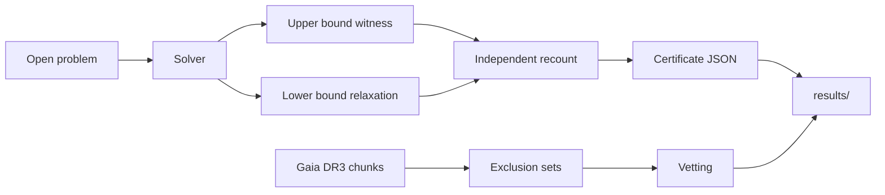

<div align="center">

# Open Research Lab

**Original results in mathematics and sky surveys — with certificates.**


[](https://github.com/adineo-cmd/open-research-lab/stargazers) [](https://github.com/adineo-cmd/open-research-lab/commits)

[Quick start](#quick-start) · [How it works](#how-it-works) · [Features](#features)

</div>

---

Split from the [Open Discovery Lab](https://github.com/adineo-cmd/open-discovery-lab)
notebook, this repository holds only results that can be re-checked: a solver, a
witness, a certificate.

It currently carries **155 machine-checkable certificates** (JSON under the
tracks' `results/certificates/` directories), a full-sky Gaia DR3
harvest of **130,318 sources**, and a discovery registry of **8,000 sources**
across 21 categories.

## Features

| | Feature | What it does |
| --- | --- | --- |
| 🔢 | **Grid Ramsey values** | Four new exact OEIS values on row 9 of A399621, plus the first bounds for the open a(9). |
| 🎯 | **Property-B covering** | A385403 extended with a(11)=9 and a(12)=9 exact, all-2ⁿ verified. |
| 🌌 | **High-proper-motion harvest** | Full-sky Gaia DR3 scan in 4,096 indexed chunks, then multi-epoch vetting. |
| 🗂️ | **Discovery registry** | 8,000 sources scored and categorised, with attribution kept per entry. |

## How it works

A result is only published when all three parts exist:

1. **A solver** — `math/*/scripts` or `math/*/tools`, with symmetry breaking where
   the search needs it.
2. **A witness** — the explicit construction that attains the value.
3. **A certificate** — JSON evidence that an independent verifier can replay.

The astronomy track runs the same discipline: a harvest query, an exclusion set
built from named catalogues, and a vetting script that records why each source
was kept or dropped.



## Quick start

Python 3.10+, `ortools` for the CP-SAT searches. Harvest scripts need network access to the Gaia TAP mirrors.

**Mathematics**

```bash
python3 math/grid-ramsey/tools/count_rects.py --help
python3 math/grid-ramsey/tools/relax_lb.py --help
python3 math/property-b-covering/scripts/verify_a385403.py --help
```

**Astronomy**

```bash
cat astronomy/high-pm-survey/RESULTS.md
python3 astronomy/high-pm-survey/scripts/check_knownness.py --help
```

## Project structure

```text
math/grid-ramsey/        A399620 / A399621 values and bounds
math/property-b-covering/ A385403 extension + verifier
math/erdos614-fnk/        FNK certificates
astronomy/high-pm-survey/ harvest, exclusion sets, vetting
discovery-engine/sources/ registry, categories, attribution
```

## What is not claimed

The record matters as much as the result. Several entries in the log are
corrections — a prior-art attribution overturned, a published guess disproven, a
method that produced no signal. Those stay, because a research log that only
records wins is not a research log.

OEIS submissions are drafted in-repo and filed only after owner review.
