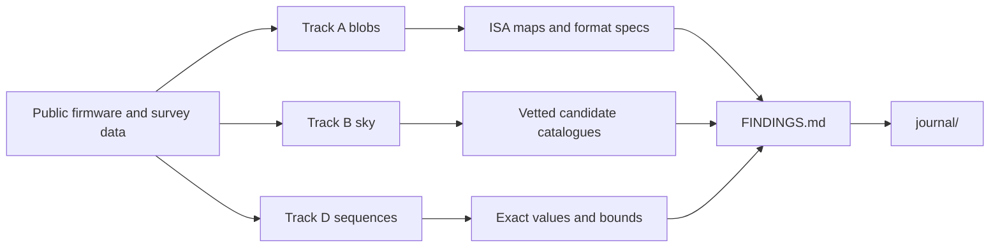

<div align="center">

# Open Discovery Lab

**Original research into the things nobody wrote down.**

 

[](https://github.com/adineo-cmd/open-discovery-lab/stargazers) [](https://github.com/adineo-cmd/open-discovery-lab/commits)

[Quick start](#quick-start) · [How it works](#how-it-works) · [Features](#features)

</div>

---

Four research tracks, one rule: **document what is true, do not rebuild what
already exists.** The lab works on problems that are unattended rather than hard
— firmware nobody specified, sky sources nobody catalogued, integer sequences
nobody extended, file formats nobody decoded.

Findings land in [`FINDINGS.md`](FINDINGS.md) — **70 dated entries**, each with a
prior-art check and a reproducible script — and in a day-by-day journal.

## Features

| | Feature | What it does |
| --- | --- | --- |
| 📡 | **Track A — Android blobs** | Clean-room ISA and format analysis of vendor firmware, with derived metadata only. |
| 🔭 | **Track B — sky mining** | Chunked Gaia DR3 harvests and multi-epoch vetting of uncatalogued high-proper-motion sources. |
| 🧰 | **Track C — discovery engine** | A source registry and scoring pipeline that finds open problems with no prior art. |
| 🔢 | **Track D — grid Ramsey** | Exact-value and bound search on OEIS rectangle-counting sequences. |

## How it works

Every track follows the same loop: **verify the gap, then earn the result.**

1. Check prior art and record the date it was checked.
2. Write a script that produces the evidence, not just a conclusion.
3. Keep the negative results — several findings are corrections of published claims.
4. Land the result in `FINDINGS.md` with its journal entry.



## Quick start

Python 3.10+. Most tools use only the standard library; disassembly needs
`capstone` and the CP-SAT probes need `ortools`.

**Inspect a track**

```bash
cat FINDINGS.md                       # every finding, dated
ls journal/                           # one file per working day
cat track-a-android-blobs/README.md
```

**Run a tool**

```bash
python3 track-a-android-blobs/tools/census.py --help
python3 track-b-sky-mining/scripts/vet.py --help
python3 track-d-grid-ramsey/tools/min_mono_rect.py --help
```

## Project structure

```text
FINDINGS.md          dated result log, one row per finding
journal/             day-by-day working notes
track-a-android-blobs/
  docs/              ISA maps, format specs, protocol notes
  tools/             extraction, disassembly, census scripts
  results/           derived metadata only
track-b-sky-mining/
  scripts/           chunked TAP harvest + vetting
  results/           candidate tables
track-c-discovery-engine/
  docs/              registry and scoring design
track-d-grid-ramsey/
  tools/             CP-SAT and relaxation solvers
  results/           witnesses and probes
SCOPE.md             what the lab will and will not do
```

## Evidence policy

- Every claim carries the date its prior art was checked.
- Every result ships a script that regenerates it.
- Negative and corrected results stay in the log — they are findings too.
- Proprietary binaries are never committed; only derived metadata (headers,
  segment tables, hashes, version strings, constants) is stored.

`SCOPE.md` defines the boundary; `AGENTS.md` defines how work in this repository
is conducted.
